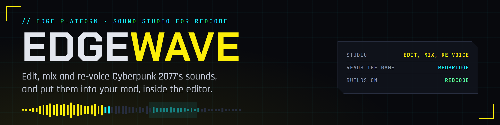
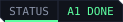

<p align="center">
  
</p>

<p align="center">
  <a href="https://edgemodders.github.io/EDGEwave/"></a>
  
  <a href="https://github.com/Edgemodders/REDcode"></a>
  <a href="https://github.com/Edgemodders/REDbridge"></a>
  <a href="LICENSE"></a>
</p>

The sound studio for Cyberpunk 2077 modding, as a VS Code extension. Part of the EDGE platform, beside [REDcode](https://github.com/Edgemodders/REDcode).

**[Read the docs](https://edgemodders.github.io/EDGEwave/)** &middot; [Design](https://edgemodders.github.io/EDGEwave/design.html)

> [!NOTE]
> **Status: A1 Edit, A2 Mix, A3 Into the game and V1 Voice tools done.** Open a sound from REDcode, edit it, mix it with other sounds and effects, and put it into your mod: override a sound effect, or replace or silence an event with REDmod. Generate Sound, Speak Line and Re-Voice through ElevenLabs, with your own key. Next: the first release.

REDcode finds and plays a game sound; **Open in EDGEwave** takes it into the studio. There you will edit it, layer and mix it with effects, and put the result into the mod you are making in REDcode, to add or override a game sound. Through ElevenLabs, with your own key: **Generate Sound** from a prompt, **Speak Line** in a voice, and **Re-Voice** a line into another voice; **Translate** is planned. Later, EDGEwave will index all of the game's audio from your own install and search it: sound effects, voice-over with its subtitles, music and radio, with what plays each sound and why.

| Part of EDGE | Role for EDGEwave |
|---|---|
| [REDbridge](https://github.com/Edgemodders/REDbridge) | Reads the game's archives, sound banks and Opus packs, and converts audio |
| [REDcode](https://github.com/Edgemodders/REDcode) | Owns the mod project that sounds go into; finds and plays game sounds and opens them in EDGEwave |
| [REDnode](https://github.com/Edgemodders/REDnode) | Plays sounds in the running game (its Sound API is planned) |

EDGEwave's search is a clean-room implementation inspired by [Cyberpunk 2077 SoundDB](https://gitlab.com/cp2077-sounddb/frontend) by Zhincore: it uses none of SoundDB's code or data, only what its public documentation describes. See the design for the rule.

## Repository layout

| Path | Contents |
|---|---|
| `src/` | The extension |
| `docs/` | The documentation site |
| `tools/brand/` | Makes the banner, social preview, icon and badges (`.\tools\brand\render.ps1`) |

## Build

```powershell
npm install
npm run build
```

[Dev setup](https://edgemodders.github.io/EDGEwave/dev-setup.html) has the details.

## License

MIT. EDGEwave never contains game files or data extracted from the game.
